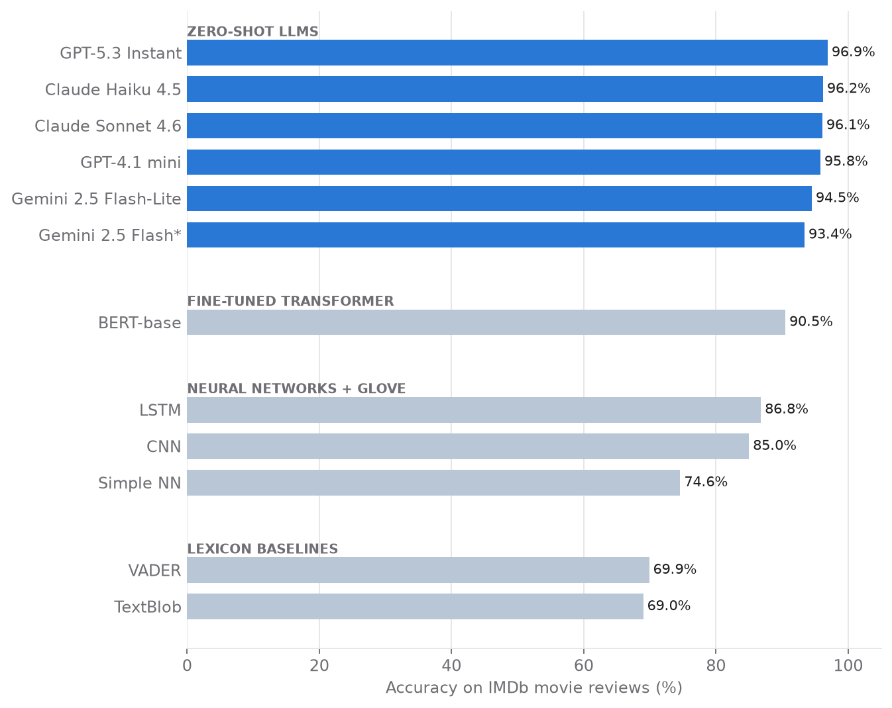

# From Lexicons to Large Language Models: a Sentiment Benchmark

   

**Case study:** [rolandkeszi.github.io/projects/llm-benchmark.html](https://rolandkeszi.github.io/projects/llm-benchmark.html)

Twelve models solve the same task: classifying **IMDb movie reviews** as positive or negative. They cover four generations of NLP: lexicon methods, neural networks, a fine-tuned BERT and zero-shot large language models from OpenAI, Anthropic and Google.

## Results: zero-shot LLMs

Every LLM labelled the **same fixed random sample of 1,000 reviews** (524 negative, 476 positive). The prompt allowed only "positive" or "negative" as the answer.

| Model | Accuracy | Precision | Recall | F1 | Misclassified |
|---|---:|---:|---:|---:|---:|
| **GPT-5.3 Instant** | **0.969** | 0.963 | 0.973 | **0.968** | 31 |
| Claude Haiku 4.5 | 0.962 | 0.945 | **0.977** | 0.961 | 38 |
| Claude Sonnet 4.6 | 0.961 | 0.947 | 0.973 | 0.960 | 39 |
| GPT-4.1 mini | 0.958 | 0.954 | 0.958 | 0.956 | 42 |
| Gemini 2.5 Flash-Lite | 0.945 | 0.953 | 0.931 | 0.942 | 55 |
| Gemini 2.5 Flash¹ | 0.934 | **0.958** | 0.910 | 0.933 | 42 |

Precision, recall and F1 are for the positive class. ¹ Only 634 of 1,000 reviews received a valid label, because of API errors.

## Results: earlier generations

| Approach | Model | Evaluated on | Accuracy |
|---|---|---:|---:|
| Fine-tuned transformer | `bert-base-uncased`, 2 epochs on 9,600 reviews | 1,200 test reviews | 0.905 |
| Neural network + GloVe | LSTM | 10,000 test reviews | 0.868 |
| Neural network + GloVe | CNN | 10,000 test reviews | 0.850 |
| Neural network + GloVe | Simple network | 10,000 test reviews | 0.746 |
| Lexicon | VADER | all 50,000 reviews | 0.699 |
| Lexicon | TextBlob | all 50,000 reviews | 0.690 |

The evaluation sets differ between approaches, so compare models within a group.

## Findings

- **LLMs win without any training data.** Every zero-shot LLM beat the fine-tuned BERT by about 3 to 6 percentage points.
- **Bigger is not automatically better.** Claude Haiku 4.5 matched Claude Sonnet 4.6 (96.2% vs 96.1%) at a fraction of the cost.
- **Lexicons lean positive.** TextBlob's recall is 0.95, but its precision is only 0.63.
- **The LSTM generalises best of the classic networks.** Its train–test gap is 1.1 points, against about 10 points for the CNN and the simple network.
- **Failures are reported, not hidden.** API errors are counted, and every misclassified review is listed for qualitative analysis.

## Notebooks

| Notebook | Content |
|---|---|
| [`01_lexicon_baselines_and_neural_networks`](notebooks/01_lexicon_baselines_and_neural_networks.ipynb) | Exploratory analysis, TextBlob and VADER, then a simple network, a CNN and an LSTM on GloVe embeddings. Includes predictions on unseen reviews. |
| [`02_bert_fine_tuning`](notebooks/02_bert_fine_tuning.ipynb) | Fine-tuning `bert-base-uncased` with Hugging Face Transformers, evaluation and error analysis. |
| [`03_llm_openai_gpt`](notebooks/03_llm_openai_gpt.ipynb) | Zero-shot classification with GPT-4.1 mini and GPT-5.3 Instant. |
| [`04_llm_anthropic_claude`](notebooks/04_llm_anthropic_claude.ipynb) | Zero-shot classification with Claude Haiku 4.5 and Claude Sonnet 4.6. |
| [`05_llm_google_gemini`](notebooks/05_llm_google_gemini.ipynb) | Zero-shot classification with Gemini 2.5 Flash and Flash-Lite. |

The notebooks were run in Google Colab and their comments are in Hungarian. API keys are read from Colab Secrets, never stored in code. To re-run a notebook, mount your own Drive or adjust the data paths.

`data/imdb_unseen_sample.csv` holds ten reviews from the original Stanford IMDb dataset, used to test the trained LSTM on unseen data.

## Data

Maas, A. L., Daly, R. E., Pham, P. T., Huang, D., Ng, A. Y., & Potts, C. (2011). Learning word vectors for sentiment analysis. *ACL*. [Large Movie Review Dataset](https://ai.stanford.edu/~amaas/data/sentiment/).
